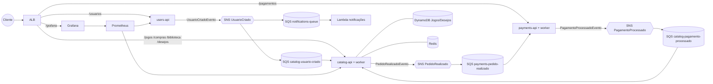

# Visão geral

Verificado em 2026-11-10 (main dos repositórios + AWS, só leitura).

FCGames: loja de jogos em microsserviços .NET 10 que conversam por eventos (MassTransit). Dois
ambientes:

| | Local | AWS |
|---|---|---|
| Como sobe | `docker compose up` no `fcg-orchestration` | botão **Ligar cluster EKS** (cluster `fcg-eks`, liga/desliga por sessão) |
| Mensageria | RabbitMQ | SNS (um tópico por evento) + SQS (uma fila por consumidor) |
| Notificações | worker `fcg-notifications-service` | Lambda `fcg-notifications-lambda` |
| Jogos | DynamoDB local | DynamoDB `Jogos`/`Desejos` |
| Entrada | portas 5001–5004 | um ALB com rotas por caminho |

## Fluxos

**Cadastro:** `POST /usuarios` → users grava o usuário e publica `UsuarioCriadoEvento` → o worker do
catalog cria a biblioteca vazia → a notificação registra o "e-mail de boas-vindas".

**Compra aprovada (preço ≤ R$ 100):** `POST /compras` (JWT) → catalog cria pedido `Pendente`,
publica `PedidoRealizadoEvento` e responde 202 com `orderId` → o worker do payments aprova, grava o
pagamento e publica `PagamentoProcessadoEvento` → o worker do catalog marca o pedido `Aprovado` e
põe o jogo na biblioteca.

**Compra rejeitada (preço > R$ 100 ou ≤ 0):** mesmo caminho; o payments publica `Rejeitado`
("Limite de crédito excedido" / "Valor inválido") e o catalog marca o pedido `Rejeitado`, sem jogo
na biblioteca. Na AWS a notificação de compra **não** acontece hoje (ver `notifications.md`).

## Repositórios (GitHub FIAP-POS-TECH-TEAM-10)

| Repositório | Papel |
|---|---|
| `fcg-users-service` | users-api |
| `fcg-catalog-service` | catalog-api + worker |
| `fcg-payments-service` | payments-api + worker |
| `fcg-notifications-service` | worker de notificações (local) |
| `fcg-notifications-lambda` | Lambda de notificações (AWS) + Terraform dela |
| `fcg-integration-events` | pacote NuGet com os 3 eventos |
| `fcg-orchestration` | compose, Terraform do EKS, manifests, botões, `.http`, esta skill |
| `fcg-observabilidade-service` | aposentado (só README) |

Fontes: README de cada repositório; `fcg-orchestration/k8s/eks/ingress.yaml`; `aws sns list-subscriptions`.
